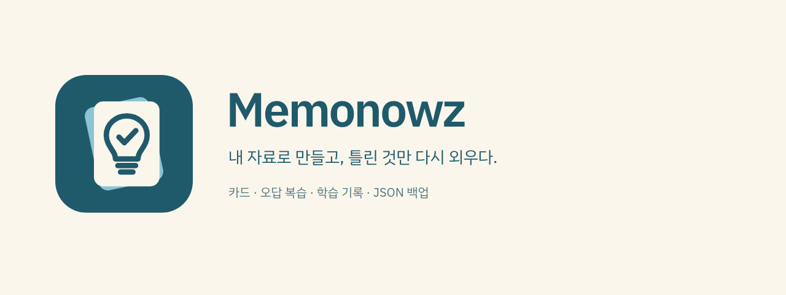
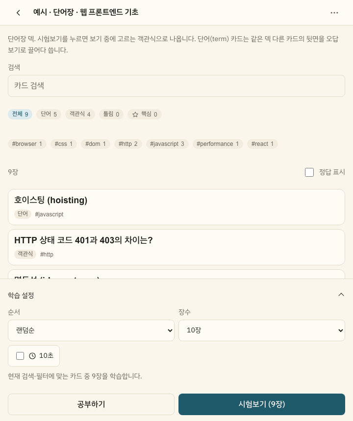
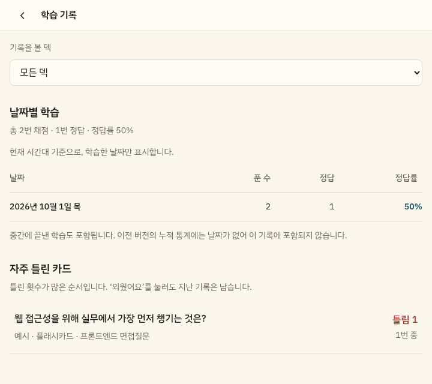

내가 가진 단어·기출문제·면접 질문을 덱으로 만들고 반복해서 푸는 **로컬 우선 암기 PWA**입니다. 계정 없이 시작하고, 카드와 학습 기록은 접속한 주소의 브라우저에 저장합니다.

**[앱 바로 열기](https://memonowz.vercel.app)** · [JSON·붙여넣기 가이드](docs/card-authoring.md) · [예시 덱](docs/examples/sample-deck.json) · [변경 기록](CHANGELOG.md)

[](https://github.com/jaymunsh/memonowz/actions/workflows/ci.yml)

## 1분 안에 시작하기

1. [앱](https://memonowz.vercel.app)을 열고 **설정 → 예시 덱 넣기 → 가져오기**를 누릅니다.
2. 단어장과 플래시카드 덱을 하나씩 열어 **공부하기**로 답을 살펴봅니다.
3. **시험보기**로 풀고, 결과에서 **틀린 것만 다시** 복습합니다.
4. 내 자료를 넣으려면 홈에서 덱을 만든 뒤 **덱 메뉴 → 불러오기**를 사용합니다.

설정에서 글자 크기와 테마를 바꿀 수 있습니다. 브라우저의 설치 메뉴로 홈 화면이나 독립 창에서도 사용할 수 있습니다. 온라인에서 앱을 한 번 열어 캐시가 준비된 뒤에는 저장된 덱을 오프라인에서도 학습할 수 있습니다.

## 내가 공부할 자료에 맞춰

| 할 일 | Memonowz에서 하는 방법 |
|---|---|
| 단어와 용어 외우기 | **단어장**에서 보기를 골라 채점합니다. 오답을 직접 적거나 같은 덱의 다른 단어에서 가져옵니다. |
| 긴 답변 떠올리기 | **플래시카드**에서 답을 뒤집어 확인하고 ‘몰랐음·알았음’으로 스스로 채점합니다. |
| 틀린 카드만 복습하기 | 검색·유형·태그·틀림·핵심(★) 필터를 적용합니다. 결과에서도 오답만 다시 풀 수 있습니다. |
| 짧게 나눠 공부하기 | 랜덤순·글자순, 10·20·50·전체 장수를 선택합니다. 단어장에는 문제마다 10초 제한을 켤 수 있습니다. |
| 중간에 나갔다 돌아오기 | 덱별 **이어하기**를 제공합니다. 마지막 학습 조건과 정답 표시 선택도 기억합니다. |
| 학습한 만큼 살펴보기 | **학습 기록**에서 날짜별 정답률과 자주 틀린 카드를 확인합니다. 중간에 끝낸 시험도 기록됩니다. |
| 편하게 읽기 | 라이트·다크·시스템 테마와 글자 크기 기본·크게·아주 크게(16·18·20px 기준)를 지원합니다. |

공부하기는 기록 없이 앞뒤를 살펴보는 모드입니다. 시험보기에서 채점한 답만 통계와 학습 기록에 쌓입니다. 자동 간격반복(SRS), 계정·클라우드 동기화, 앱 안의 AI 생성 기능은 아직 없습니다.

<details>
<summary>실제 화면 보기 — 덱과 학습 기록</summary>

### 덱에서 고르고, 필요한 만큼 시험보기



### 중간에 끝내도 남는 학습 기록



위 화면은 앱에 포함된 예시 덱을 사용하는 모습입니다.

</details>

## 내 자료 가져오기

### Excel·Google Sheets는 두 열만 복사

첫 열에 앞면, 둘째 열에 뒷면을 적고 **제목 행 없이** 복사합니다. 덱 메뉴 → 불러오기 → 붙여넣기에 넣으면 `term` 카드로 바뀝니다. 기본 설정은 **한 줄에 한 장 / 탭 (Excel·Sheets)** 입니다.

직접 입력할 때는 앞뒤 나누기 → 직접 입력에서 `::`를 지정해 다음처럼 쓸 수도 있습니다.

```text
cohesion::응집도
coupling::결합도
```

입력 즉시 앞뒤와 장수를 미리 보고, 제외되는 행의 위치와 이유를 확인할 수 있습니다. 저장 버튼을 눌러야 덱에 추가됩니다.

### JSON으로 설명과 객관식까지

아래 전체 내용을 UTF-8 일반 텍스트 파일 `my-deck.json`으로 저장합니다. **설정 → 백업 또는 덱 파일 가져오기**에서 선택하고 확인 창의 **가져오기**를 누르면 새 덱이 생깁니다.

```json
{
  "deck": {
    "name": "소프트웨어 설계",
    "flipOnly": false
  },
  "cards": [
    {
      "type": "term",
      "front": "cohesion",
      "back": "응집도",
      "distractors": ["결합도", "추상화", "캡슐화"],
      "tags": ["설계"],
      "explanation": "한 모듈 안의 요소들이 같은 목적에 모인 정도다.",
      "starred": true
    },
    {
      "type": "mcq",
      "question": "모듈 사이의 의존 정도를 뜻하는 것은?",
      "choices": ["응집도", "결합도", "상속"],
      "answer": 1,
      "explanation": "결합도는 모듈 사이, 응집도는 모듈 내부를 본다."
    }
  ]
}
```

- `answer`는 **0부터 세는 보기 위치**입니다. `1`은 두 번째 보기인 ‘결합도’를 뜻합니다.
- `flipOnly: true`로 만들면 답을 떠올리고 뒤집어 채점하는 플래시카드 덱이 됩니다.
- 기존 덱에 카드만 추가할 때는 `cards` 배열의 내용만 `[ ... ]`로 감싼 파일도 사용할 수 있습니다. 설정에서는 새 덱의 이름이 필요합니다.
- JSON은 **파일 선택**으로 가져옵니다. JSON 코드를 텍스트 붙여넣기 칸에 넣는 방식은 지원하지 않습니다.

[카드 작성 가이드](docs/card-authoring.md)에 필드 규칙, 여러 덱을 담는 파일, 긴 답 붙여넣기, 오류 처리와 외부 AI용 프롬프트를 정리했습니다. 바로 실행해 볼 파일은 [sample-deck.json](docs/examples/sample-deck.json)입니다.

## 자료 공유와 학습 백업

| 파일 | 내보내는 위치 | 포함하는 정보 |
|---|---|---|
| 덱 교환 파일 | 덱 메뉴 → 덱 내보내기 | 덱 유형, 카드 내용·태그·설명·핵심 표시 |
| 전체 백업 | 설정 → 전체 백업 내보내기 | 덱·카드, 누적 통계, 생성 시각, 이어하기·마지막 결과, 날짜별 채점 기록 |

**전체 백업 복원은 설정에서 합니다.** 기존 덱을 유지하면서 새 ID로 덱을 추가하고 기록·세션 참조도 함께 옮깁니다. 같은 파일을 다시 가져오면 덱도 다시 추가됩니다. 덱의 불러오기에서 전체 백업을 선택하면 카드 내용만 추가되며 학습 상태는 복구되지 않습니다.

데이터는 **주소·브라우저·기기별로 따로 저장**됩니다. 로컬 주소에서 배포 주소로 옮기거나 브라우저 데이터를 삭제하기 전에 전체 백업을 다운로드하세요. 테마·글자 크기·마지막 학습 설정은 백업에 포함되지 않습니다.

날짜별 기록은 기록 기능이 추가된 뒤 실제로 채점한 답부터 쌓입니다. 이전 버전의 날짜 없는 누적 통계를 추정해 과거 기록으로 만들지 않습니다. 카드를 삭제하거나 ‘외웠어요’를 눌러도 지난 기록은 유지되며, 덱을 삭제하면 해당 덱의 기록도 삭제됩니다.

## 키보드로 학습하기

| 모드 | 키 |
|---|---|
| 시험 | 숫자키로 보기 선택 · `Space`로 답 보기·다음 |
| 뒤집기 채점 | 답을 본 뒤 `1` 몰랐음 · `2` 알았음 |
| 공부 | `Space`로 답 보기·다음 · 방향키로 이전·다음 |

입력창과 편집 모달에서는 학습 단축키가 동작하지 않습니다. 버튼에 포커스가 있으면 Space는 그 버튼의 기본 동작을 유지합니다.

## 로컬 실행과 검증

Node.js 24와 Corepack을 사용합니다. pnpm 버전은 `packageManager`에 고정되어 있습니다.

```sh
git clone https://github.com/jaymunsh/memonowz.git
cd memonowz
corepack pnpm install --frozen-lockfile
corepack pnpm dev
```

```sh
corepack pnpm check                 # strict TypeScript + 단위 테스트
corepack pnpm build                 # 프로덕션 PWA 빌드
corepack pnpm preview               # 빌드 결과 확인
corepack pnpm exec playwright install chromium
corepack pnpm test:e2e              # 브라우저 회귀 테스트
```

Vitest는 스키마·파서·출제·편집·트랜잭션·마이그레이션·백업을 검증합니다. Playwright는 실제 IndexedDB로 편집·이어하기·새로고침·저장 실패 재시도·백업 복원과 키보드 조작을 확인합니다. 브라우저 테스트는 개인 덱과 분리된 새 컨텍스트에서 실행합니다.

설치된 Chromium을 사용하려면 `PLAYWRIGHT_CHROMIUM_EXECUTABLE_PATH`를 지정할 수 있습니다. GitHub Actions는 타입 검사·단위 테스트·빌드·브라우저 테스트를 실행합니다.

## 구조와 배포

React · TypeScript · Vite · Dexie · Zod로 구성했습니다.

| 경로 | 역할 |
|---|---|
| `src/types` | 카드·덱·세션·기록·백업 스키마 |
| `src/db` | IndexedDB CRUD, 트랜잭션, 백업과 복원 |
| `src/card`, `src/deck`, `src/study` | 카드 편집과 학습 화면 |
| `src/import` | 파일 검증과 텍스트 붙여넣기 |
| `src/app`, `src/ui` | 라우팅·설정·오류 처리와 공통 UI |
| `tests/e2e` | 실제 브라우저 회귀 테스트 |

채점 통계·세션 진행도·날짜별 기록은 하나의 트랜잭션으로 저장합니다. 저장에 실패하면 다음 문제로 진행하지 않으며 재시도로 횟수가 중복 누적되지 않습니다.

[Vercel 공개 앱](https://memonowz.vercel.app)은 `vercel.json`의 Vite 빌드·`dist` 출력·SPA 경로 설정으로 배포합니다. CLI에서 프로젝트를 연결한 뒤 `vercel --prod`를 사용합니다. Git push 자동 배포를 사용하려면 Vercel GitHub 앱을 설치하고 저장소를 연결해야 합니다.

다른 HTTPS 정적 호스팅도 사용할 수 있습니다. 모든 앱 경로를 `index.html`로 보내는 SPA fallback을 설정하세요. PWA 설치와 오프라인 검증은 개발 서버가 아닌 빌드 결과에서 진행합니다. 사용한 폰트 서브셋을 실행 중 캐시하므로 아직 캐시하지 않은 글자는 오프라인에서 시스템 폰트로 보일 수 있습니다. [로컬·모바일 테스트 절차](docs/local-testing.md)를 참고하세요.

초기 설계 기록은 `docs/superpowers/`에 보관했습니다. 현재 기능과 데이터 계약은 이 README, 카드 작성 가이드와 코드가 기준입니다.

아이콘 원본과 README·공유용 이미지의 위치는 [브랜드 자산 안내](docs/branding.md)에 정리했습니다.
