# Memonowz — 설계는 Claude, 구현은 Codex로 나눠 만든 기록

암기용 PWA 하나를 만들면서, **Claude는 설계와 검증만 하고 코드는 Codex 워커가 전부 쓰는** 구조로 진행했다. Orca의 멀티 오케스트레이션을 실제로 굴려본 기록이다.

계획이 완성된 시점부터 통합이 끝날 때까지 **45분**, 그중 병렬 구간이 **13분 30초**였다. 커밋 28개, 소스 파일 56개, 테스트 31개.

이 문서는 무엇을 만들었는지보다 **어디서 새고 어디서 잡혔는지**에 지면을 쓴다. 무엇을 했는지는 git log에도 남지만, 무엇을 시도했다 실패했는지는 여기에만 남는다.

> 자료 위치: 이미지는 전부 같은 폴더의 `assets/` 아래에 있다.

---

## 1. 무엇을 만들었나

덱에 카드를 넣고, 객관식으로 반복해서 풀고, **틀린 것만 다시 푸는** 로컬 전용 PWA. 서버도 계정도 없고 데이터는 브라우저 IndexedDB에만 있다.

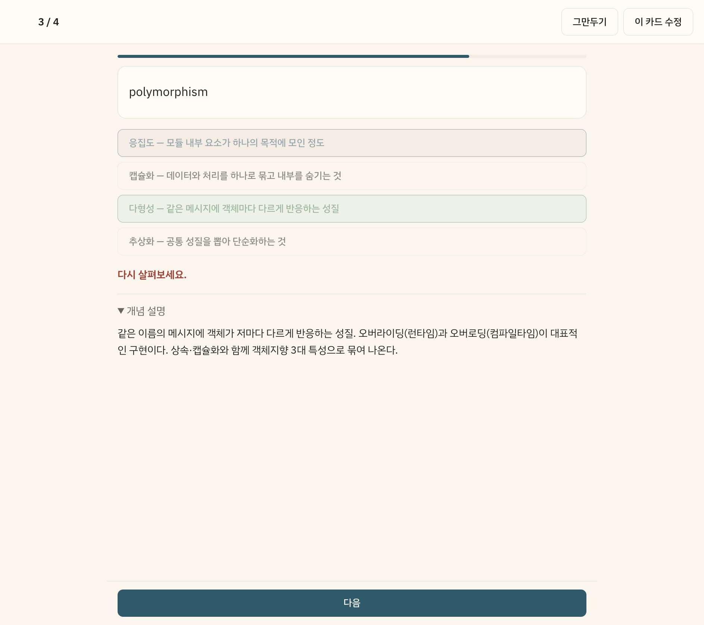

*채점 화면. 이 앱 설계의 핵심이 여기 다 들어 있다 — 오답이면 개념 설명이 자동으로 펼쳐지고, 맞으면 접힌 채로 둔다. 그래서 별도의 오답노트 화면이 필요 없다. `다음` 버튼은 하단 고정이라 긴 해설을 다 읽지 않고도 넘어갈 수 있다.*

카드 유형은 셋으로 고정했다.

| type | 필드 | 출제 방식 |
|---|---|---|
| `term` | `front`, `back` | 4지선다. 오답 보기는 **같은 덱 다른 카드의 뒷면**에서 자동 추출 |
| `mcq` | `question`, `choices[]`, `answer` | 그대로 4지선다, 보기 순서만 셔플 |
| `qa` | `question`, `answer` | 뒤집기 + 자가채점. 기술면접 질문이 여기 |

세 유형 모두 `explanation`을 공통으로 갖는다. 이 하나가 오답노트를 대체한다.

---

## 2. 코드를 쓰기 전에 정한 것들

### 2.1 디자인을 먼저 눈으로 확인했다

설계 문서에 색 코드를 적어두는 것만으로는 승인할 실체가 없다. 그래서 구현 전에 **토큰·공통 컴포넌트·전체 화면 목업을 실제로 렌더해서** 확인받았다.

여기서 실제로 바뀐 것들:

- 강조색을 테라코타에서 **딥 페트롤(`#1F5A6B`)** 로. 아이보리 + 테라코타 + 세리프는 생성형 결과물의 기본값처럼 굳어진 조합이라, 바탕과 대비되는 한색으로 돌렸다
- 서체를 두 벌에서 **IBM Plex Sans KR 한 벌**로. 제목은 다른 서체가 아니라 같은 서체의 굵기와 자간으로 구분한다
- 라이트 모드를 순백이 아니라 **아이보리(`#FAF6EC`)** 로. 20~40분씩 텍스트를 응시하는 앱이라 흰 배경의 대비가 그대로 피로가 된다

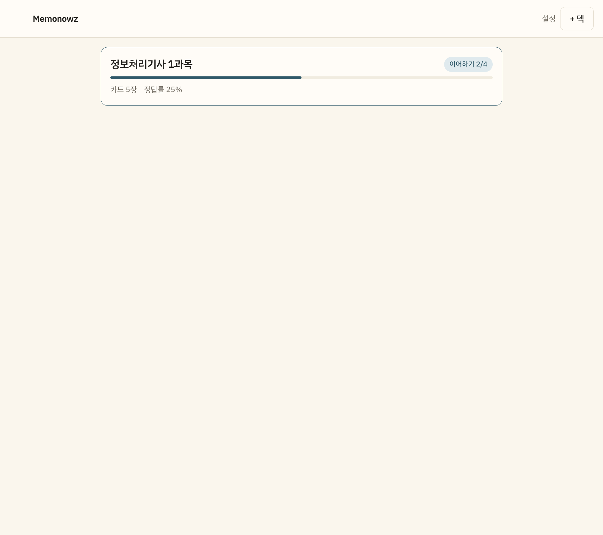

*아이보리 바탕과 딥 페트롤 강조색. 목업에서 승인한 값이 그대로 구현에 들어갔다.*

**이 단계를 앞에 두지 않았다면** 세 워커가 각자 그럴듯한 버튼을 세 종류 만들었을 것이다. 통합할 때 그걸 하나로 합치는 비용이 병렬로 아낀 시간을 넘는다.

### 2.2 모듈 경계 = 병렬 경계

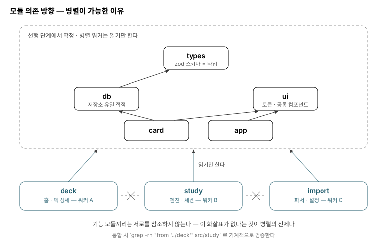

*이 그림의 요점은 화살표가 **있는** 곳이 아니라 **없는** 곳이다.*

세 기능 모듈(`deck`/`study`/`import`)은 공유 모듈만 읽고 서로를 참조하지 않는다. 이 "참조 없음"이 병렬의 전제이고, 통합할 때 `grep`으로 기계적으로 검증할 수 있는 조건이기도 하다.

설계 중에 한 번 위험했던 지점이 있다. 학습 중에 카드의 오타를 그 자리에서 고칠 수 있게 하기로 했는데, 카드 편집 모달을 `deck/`에 두면 **`study`가 `deck`을 참조하게 되어 두 워커가 묶인다.** 그래서 `card/`라는 별도 모듈로 빼서 선행 단계에서 만들었다.

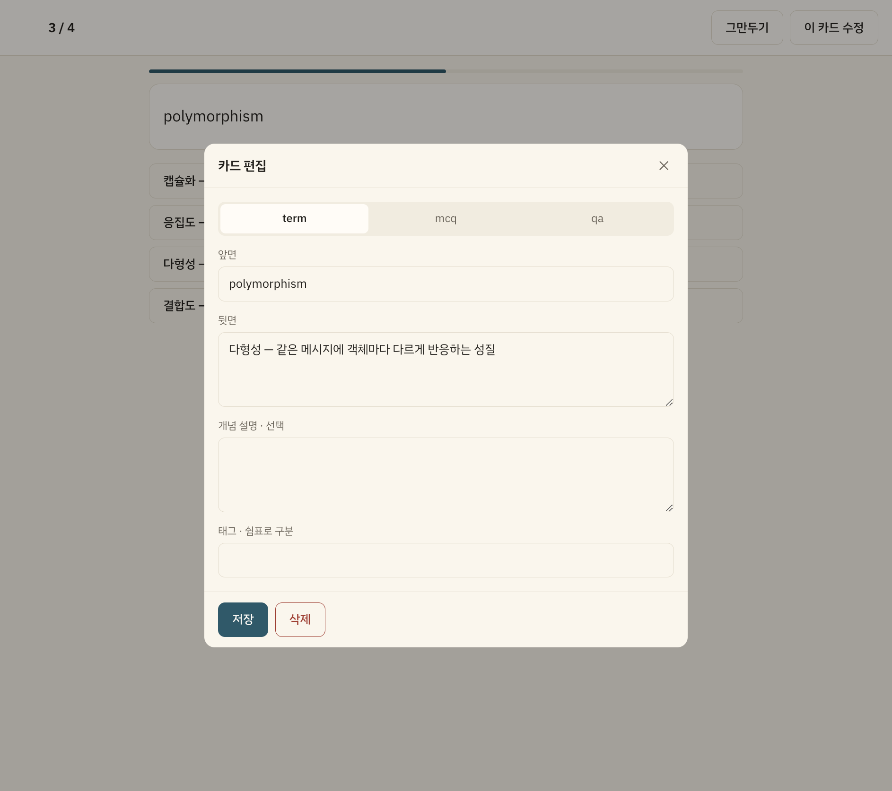

*`card/` 분리가 값어치를 낸 지점. 이 모달은 덱 상세와 학습 세션 양쪽에서 같은 코드로 뜬다.*

---

## 3. 오케스트레이션 구조

### 3.1 처음 계획은 틀렸다

내 첫 계획은 이랬다: **선행 단계(계약·공유 UI)는 코디네이터가 직접 구현하고, 마지막에 세 모듈만 병렬로 돌린다.**

사용자가 한 줄로 뒤집었다.

> "근데 이러면 멀티 오케스트레이션이 맞나?"

맞는 지적이었다. 그 구조에서는 절반이 그냥 단독 작업이고, 워커 셋이 한 층에 나란히 있을 뿐 오케스트레이션이랄 게 없다. 내가 계약의 순차성을 이유로 지나치게 안전하게 잡았는데, **실제로 순차적이어야 하는 건 `types` 하나뿐**이었다.

### 3.2 폭을 얼마나 넓힐 것인가

다시 짠 안은 최대 8워커 3층 DAG에 태스크마다 검증 에이전트를 붙이는 것이었다. 이것도 과했다.

- 병렬 폭을 넓히면 워커 토큰은 선형으로 늘지만, **코디네이터의 추적 비용은 그보다 빨리 는다**
- 검증 전용 에이전트는 코디네이터가 맥락을 못 들고 있을 때 쓰는 방식이다. 이번엔 코디네이터가 스펙과 계획을 통째로 들고 있어서, 별도 에이전트는 같은 맥락을 다시 읽히는 비용만 든다

최종적으로 **Codex 세션 4개(선행 1 + 병렬 3), 검증은 코디네이터가 직접**으로 수렴했다. 실제로는 보정 3건이 추가로 나가서 총 7회 디스패치가 됐다.

`db`와 `ui`는 서로 독립이라 병렬이 가능했지만 묶어서 하나로 돌렸다. 둘 다 짧은 작업이라 워커 기동과 머지 비용이 이득보다 컸다. 대신 **게이트를 둘로 나눠서** 계약이 잘못 나왔을 때 병렬 단계로 새어나가지 않게 막았다.

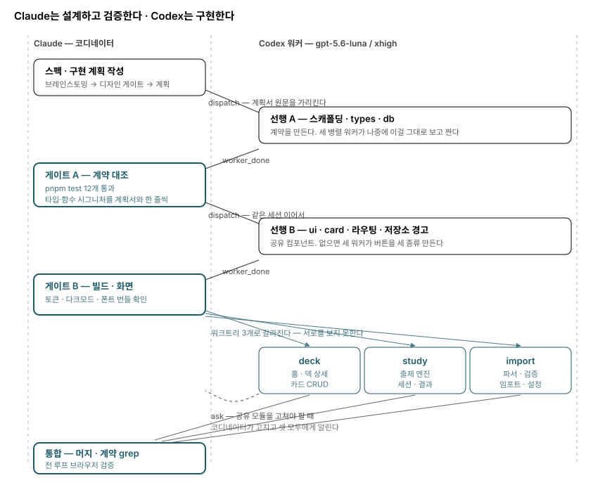

*왼쪽이 Claude(설계·검증·통합), 오른쪽이 Codex(구현). 점선 화살표는 워커가 공유 모듈을 고쳐야 할 때 코디네이터로 되돌아오는 경로다 — 한 워커만 고치게 두면 나머지 둘이 옛 계약으로 짠다.*

### 3.3 워커에게 넘긴 규칙

고추론 모델(`gpt-5.6-luna`, effort `xhigh`)의 실패 방식은 "못 알아들어서"가 아니라 **빈칸을 스스로 그럴듯하게 메워서**다. 세 워커가 각자 합리적인 판단을 내리면 통합 시점에 서로 다른 세 개의 합리가 충돌한다.

그래서 태스크 본문에 이걸 강제했다.

```
읽기만 한다 (절대 고치지 않는다):
    src/types/**  src/db/**  src/ui/**  src/card/**  src/app/**  vite.config.ts  index.html

고쳐야 한다고 판단되면 직접 고치지 말고 멈추고 물어봐라:
    orca orchestration ask --text "무엇을 왜 바꿔야 하는지"
계약은 너 말고 두 개의 다른 워커가 동시에 보고 짜고 있다. 혼자 바꾸면 통합이 깨진다.
```

마지막 문장이 중요했다고 본다. "고치지 마라"가 아니라 **왜 고치면 안 되는지**를 말해줘야 고추론 모델이 규칙을 자기 판단보다 위에 둔다.

태스크 본문은 요약하지 않고 넘겼다. 다만 CLI 인자로 계획서 250줄을 밀어넣는 대신, **워커가 같은 저장소에 있으니 파일 경로와 읽어야 할 절 이름을 지정**했다. 요약해서 넘기는 것과는 다르다 — 원문을 가리킬 뿐이다.

---

## 4. 실제로 일어난 일 (시간순)

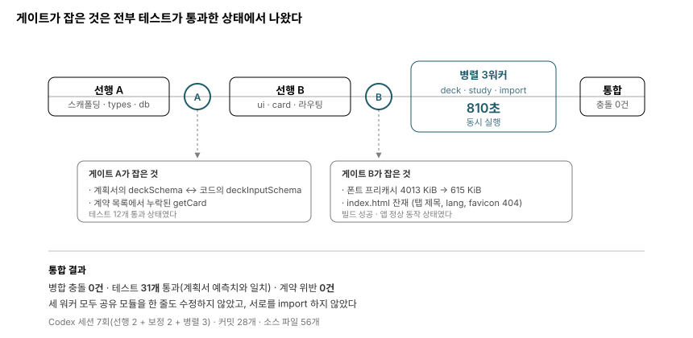

### 18:34 — 계획 확정

이 시점까지는 코드가 한 줄도 없다. 스펙 문서와 구현 계획만 커밋돼 있다.

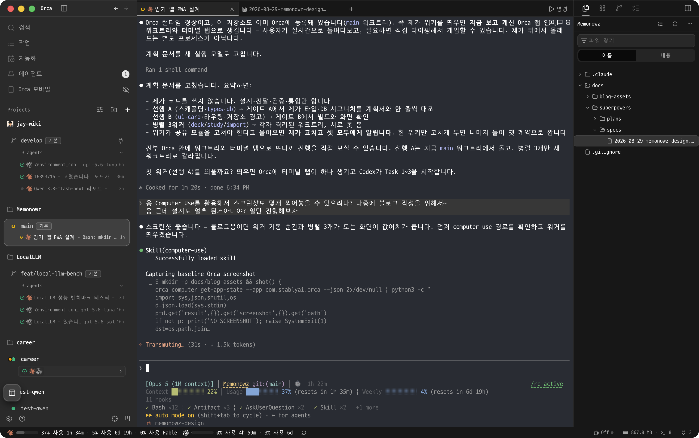

### 18:36 — 첫 워커 기동, 그리고 첫 실패

```bash
orca orchestration worker-start --agent codex --model luna --effort high
```

CLI가 `ok: true`, `stage: input_accepted`를 돌려줬다. **나는 이걸 보고 "모델이 그대로 통했다"고 보고했다. 틀렸다.**

워커 터미널을 읽어보니 이렇게 떠 있었다.

```
The 'luna' model is not supported when using Codex with a ChatGPT account.
```

실제 모델 id는 `gpt-5.6-luna`였고, effort도 `high`가 아니라 `xhigh`였다. **CLI가 인자를 받아들인 것과 모델이 실제로 붙은 것은 별개였다.**

이게 이 프로젝트에서 첫 번째로 배운 것이다. 오케스트레이션에서 **무엇을 성공 신호로 삼을 것인가**. `input_accepted`는 "입력이 전달됐다"는 뜻이지 "일이 시작됐다"는 뜻이 아니다. 이후로는 기동 직후 반드시 터미널 출력을 읽고 나서 보고했다.

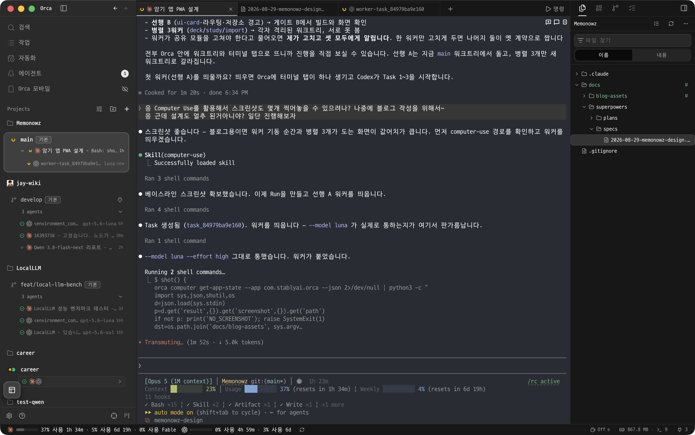

### 18:47 — 코디네이터와 워커의 git 충돌

선행 A가 도는 동안 블로그용 다이어그램을 커밋하려다 사고가 났다. 실패가 두 겹이었다.

1. 내 `git add docs/blog-assets`가 스테이징된 상태에서 커밋이 `index.lock`에 걸렸다. **그 인덱스를 워커의 커밋이 그대로 집어삼켰다** — "스캐폴딩" 메시지에 내 문서 5개만 담긴 커밋이 됐다
2. 그걸 고치려던 내 `git reset --soft HEAD~1`이, 워커가 같은 메시지로 만든 **두 번째 정상 커밋**을 되돌렸다. 같은 메시지의 커밋이 둘이라는 걸 확인하지 않고 `HEAD~1`을 친 게 두 번째 실수다

주목할 건 **워커가 이걸 스스로 감지해서 escalation으로 올렸다**는 점이다.

```
msg_a4328c18e431 [escalation] "Blocked: 동시 Git 커밋 경합으로 Task 1 커밋이 문서 커밋으로 생성됨"
```

워커가 조용히 넘어갔다면 "스캐폴딩 커밋에 스캐폴딩이 없는" 히스토리가 그대로 남았을 것이다. **blocked를 올릴 수 있는 채널이 있다는 게 실제로 값어치를 낸 지점**이다.

원인은 선행 단계를 `--worktree current`로 돌린 대가다. 별도 워크트리로 뺐다면 없었을 문제지만, 그러면 세 병렬 워커가 전부 그 브랜치를 base로 잡아야 해서 더 복잡해진다. 트레이드오프를 알고 고른 것이고, 실제로 물린 지점이 여기였다.

고친 방법: 계획서의 공통 제약에 **`git add -A` 금지, 자기 경로만 명시**를 추가하고, 워커와 코디네이터 양쪽이 지켰다. 이후로는 재발하지 않았다.

### 18:51 — 게이트 A: 테스트가 통과한 상태에서 계약 불일치 2건

선행 A가 끝났다. 테스트 12개 통과, 빌드 성공, 계획서 밖 의존성 없음. 여기서 멈추지 않고 **계약 이름을 계획서와 한 줄씩 대조**했다.

두 건이 나왔다.

1. 계획서 Task 2의 `Produces` 목록에는 `deckSchema`라고 적혀 있는데, **같은 태스크의 코드 블록은 `deckInputSchema`를 정의한다.** 워커는 코드 블록을 따랐고 그게 맞다 — 계획서 쪽 오류였다
2. `getCard`가 Task 5(카드 편집 모달) 코드에서 이미 쓰이는데 `Produces` 목록에 없었다. 워커가 알아서 만들어줬지만, **목록에 없는 함수를 병렬 워커가 있다고 가정할 수는 없다**

둘 다 테스트로는 안 잡힌다. 세 병렬 워커가 이 목록을 보고 짜기 때문에, 여기서 안 고쳤으면 세 곳에서 동시에 어긋났을 것이다.

### 19:03 — 게이트 B: 빌드가 성공한 상태에서 결함 2건

선행 B(`ui`·`card`·라우팅·저장소 경고)가 끝났다. 테스트 통과, 빌드 성공, 토큰 hex가 승인본과 전부 일치, 자리표시자 6개가 그대로 1줄 유지(워커가 범위를 넘지 않았다).

그런데 빌드 로그의 숫자를 읽어보니:

```
precache  283 entries (4013.22 KiB)
```

`@fontsource/ibm-plex-sans-kr`가 유니코드 범위별 서브셋 **274개, 3.9MB**를 뿌리는데, 내가 계획서에 써둔 `globPatterns: ['**/*.{js,css,html,woff2,png}']`가 그걸 전부 프리캐시하고 있었다. **설치 첫 실행에 4MB를 통째로 받게 된다.**

런타임 캐시(`CacheFirst`)로 옮겼다. 한 번 렌더된 서브셋은 캐시에 남아 오프라인에서도 나오고, 아직 본 적 없는 글자 범위만 시스템 폰트로 폴백된다.

```
precache  9 entries (615.12 KiB)
```

같은 게이트에서 `index.html`도 걸렸다. Vite 템플릿 잔재가 그대로였다 — `lang="en"`, `<title>memonowz-vite-mad4n1</title>`(브라우저 탭과 PWA 설치 이름에 그대로 나온다), 존재하지 않는 `favicon.svg`(404).

**이 시점까지 게이트가 잡은 3건이 전부 "테스트 통과 + 빌드 성공" 상태에서 나왔다.** 자동 검증이 통과했다는 것과 제대로 됐다는 것은 다른 얘기다. 게이트를 사람이 지키는 이유가 이것이다.

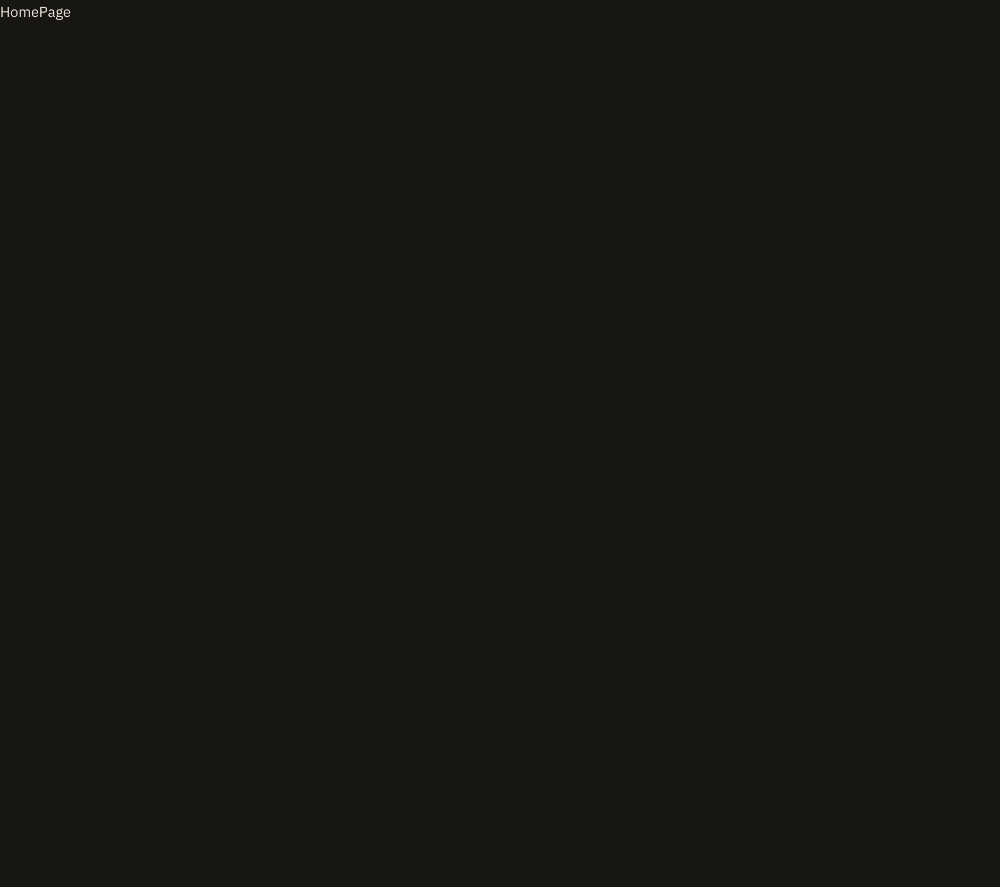

### 19:04 — 병렬 3워커

게이트 B를 통과한 커밋을 base로 워크트리 셋이 갈라졌다.

```
main
├── memonowz-deck    ~/orca/workspaces/Memonowz/memonowz-deck
├── memonowz-study   ~/orca/workspaces/Memonowz/memonowz-study
└── memonowz-import  ~/orca/workspaces/Memonowz/memonowz-import
```

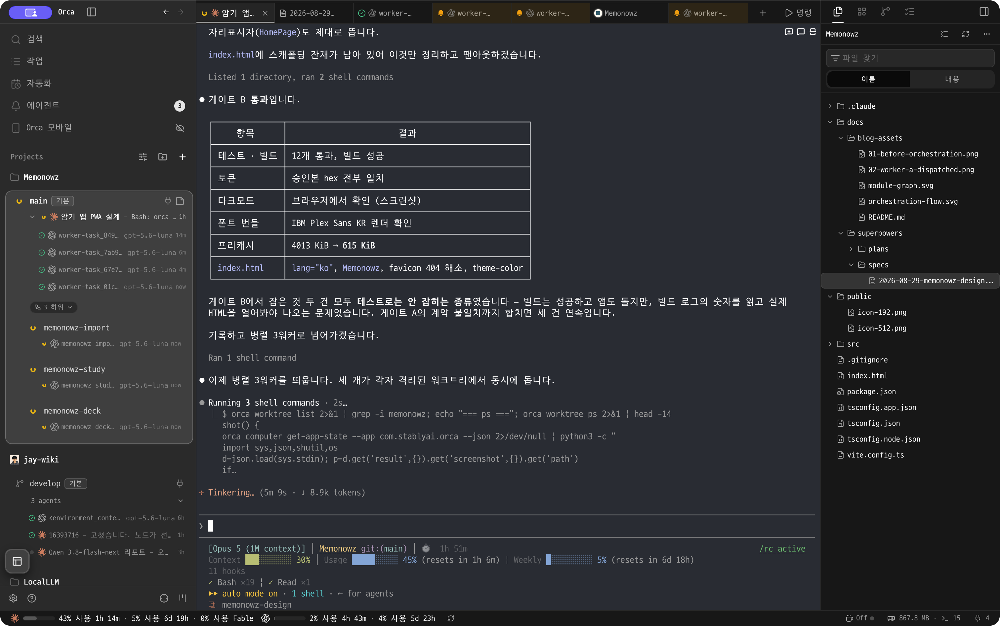

셋은 서로의 작업을 보지 못한다. 그게 분할이 새는지 확인하는 조건이다.

`import` 워커가 시작하면서 스스로 요약한 문장이 계약을 정확히 이해했음을 보여준다.

> "계약상 읽기 전용 경로는 건드리지 않으며, `src/import/`만 구현하고 빌드·테스트·브라우저 확인까지 진행하겠습니다."

### 19:12~19:18 — 완료

세 워커가 **810초(13분 30초)** 만에 전부 끝났다. 병합 전에 각 워크트리에서 검증했다.

```bash
git diff --name-only main..HEAD -- src/types src/db src/ui src/card src/app vite.config.ts index.html
# → 비어 있어야 정상

grep -rn "from '\.\./deck\|from '\.\./study\|from '\.\./import" src/deck src/study src/import
# → 비어 있어야 정상
```

**셋 다 비었다.** 공유 모듈을 한 줄도 건드리지 않았고, 서로를 import하지도 않았다. CSS 리터럴 색도 0건 — 전부 토큰 경유였다.

| 워커 | 변경 | 파일 |
|---|---|---|
| deck | +547 | `HomePage.tsx/css`, `DeckPage.tsx/css` |
| study | +505 | `engine.ts`, `engine.test.ts`, `StudyPage.tsx/css`, `ResultPage.tsx/css` |
| import | +563 | `parsePaste.ts`, `validate.ts`, 테스트 2개, `ImportPage.tsx/css`, `SettingsPage.tsx/css` |

### 19:19 — 통합

`import` → `deck` → `study` 순으로 병합했다. 뒤로 갈수록 다른 모듈을 많이 참조하므로, 충돌이 나면 늦게 병합되는 쪽에서 고치는 편이 싸다.

**병합 충돌 0건.** 테스트 31개 전부 통과했고, 이건 계획서가 예측한 숫자(types 6 + db 6 + study 9 + import 10 = 31)와 **정확히 일치**했다.

---

## 5. 완성된 앱

브라우저에서 전 루프를 실제로 통과시켜 확인했다.


*덱 상세. 카드가 0장일 때 `학습 시작`이 비활성화되는 것까지 명세대로다.*

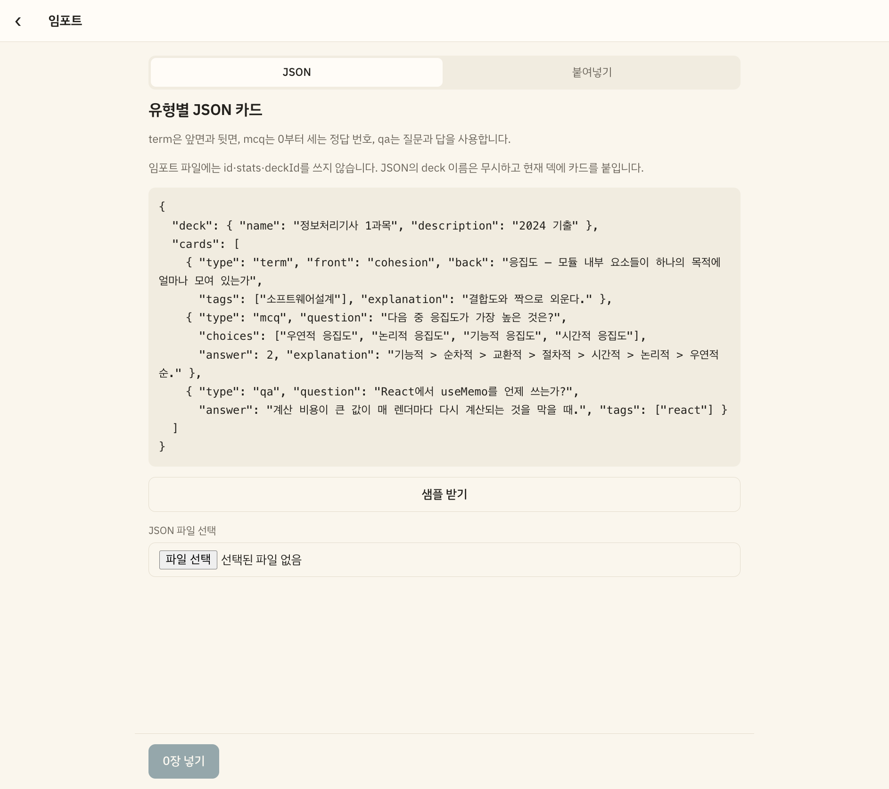

*임포트 화면. 유형별 스키마 설명과 샘플이 화면 안에 실려 있어서, 외부(에디터나 다른 AI)에서 만들어 올릴 수 있다. 검증 실패는 `3번째 항목: answer가 choices 범위를 벗어남`처럼 인덱스와 이유를 붙여 보여주고, 통과분만 넣을지 전부 취소할지 고르게 한다 — 200장 중 3장 때문에 전부 버리게 만들지 않는다.*

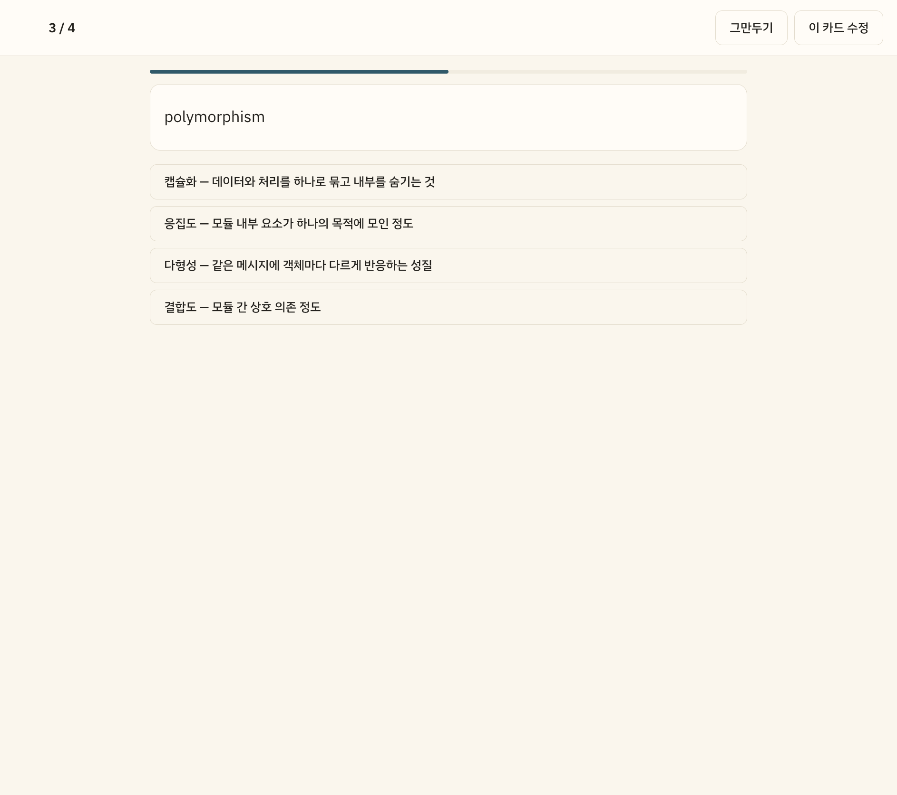

*`term` 카드의 4지선다. 오답 보기는 같은 덱 다른 카드의 뒷면에서 자동으로 뽑는다. 덱에 카드가 4장 미만이면 보기 수를 있는 만큼 줄이고, 2장도 안 되면 뒤집기로 낸다.*

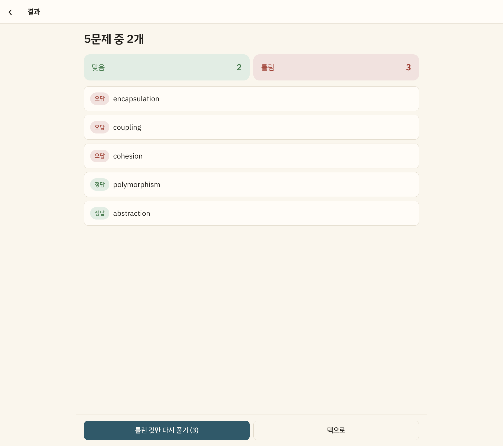

*결과 화면. 오답이 위, 정답이 아래로 푼 문제를 전부 보여주고 각 항목은 탭하면 펼쳐진다. 세션 중에 이전 문제로 되돌아가고 싶은 욕구가 여기서 해소되므로, 세션에는 되돌리기를 두지 않았다.*

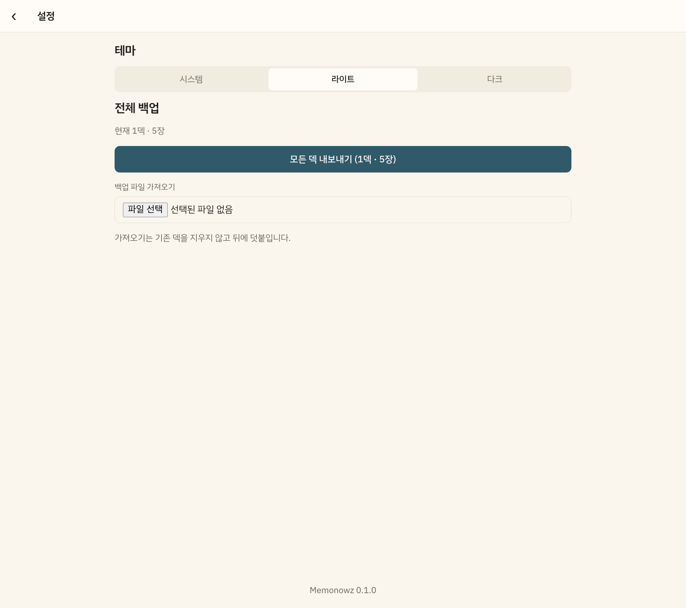

*설정. 하단 탭바를 두지 않았다 — 홈 → 덱 → 세션은 나란한 목적지가 아니라 드릴다운 계층이고, 탭바에 넣을 최상위 목적지가 홈 하나뿐이기 때문이다.*

검증한 전 루프:

덱 생성 → 붙여넣기 임포트 5장(쉼표 구분, 미리보기 정상) → 학습 시작 → 4지선다 자동 생성 → 오답 채점 → 학습 중 카드 수정 → 결과 화면 → `틀린 것만 다시 풀기 (4)` → 중간 이탈 → 홈에 `이어하기 1/4` 배지와 누적 정답률 → 설정(테마 3택, 전체 백업)

---

## 6. 배운 것

### 6.1 자동 검증 통과 ≠ 제대로 됨

게이트가 잡은 3건이 **전부 테스트 통과 + 빌드 성공 상태에서 나왔다.**

| 게이트 | 잡은 것 | 어떻게 잡았나 |
|---|---|---|
| A | 계획서 ↔ 코드의 타입 이름 불일치 | `grep`으로 export를 뽑아 계획서와 한 줄씩 대조 |
| A | 계약 목록에서 누락된 함수 | 같은 대조 |
| B | 폰트 프리캐시 4MB | 빌드 로그의 숫자를 읽음 |
| B | `index.html` 스캐폴딩 잔재 | 실제 HTML을 열어봄 |

전부 "명령을 돌려서 초록불을 확인"하는 것 이상을 요구했다. 자동화할 수 있는 것도 있다(계약 대조는 스크립트로 가능하다). 하지만 **무엇을 대조해야 하는지를 아는 것**은 설계를 들고 있는 쪽만 할 수 있다.

### 6.2 병렬 분할이 새지 않은 이유

계약 위반 0건은 운이 아니었다. 네 가지가 겹쳤다고 본다.

1. **계약(`types`/`db`)을 게이트로 먼저 확정했다.** 세 워커가 짜기 시작한 시점에 계약은 이미 검증을 통과한 상태였다
2. **공유 UI를 선행 단계에서 만들었다.** 버튼을 새로 만들 이유가 없었다
3. **`CardEditor`를 `card/`로 분리했다.** 이게 없었으면 `study`가 `deck`을 참조해서 두 워커가 묶였다
4. **"계약은 너 말고 두 워커가 동시에 보고 짜고 있다"를 태스크에 명시했다.** 금지가 아니라 이유를 줬다

### 6.3 규칙에 예외를 두지 않는 편이 싸다

폰트 프리캐시 보정은 `vite.config.ts` 3줄짜리 변경이었다. 코디네이터가 직접 고치는 게 명백히 빨랐지만 워커에 재디스패치했다. `index.html` 정리도 마찬가지였다.

**어디까지가 코디네이터의 일인지 매번 판단하는 비용이, 규칙을 예외 없이 지키는 비용보다 크다.** 한 번 "이 정도는 내가"를 허용하면 그 경계를 계속 재협상하게 된다.

### 6.4 실패 목록

정직하게 남겨둔다.

- **모델 id를 확인하지 않고 성공을 보고했다.** `--model luna`가 CLI를 통과한 것만 보고 "통했다"고 말했다. 실제 id는 `gpt-5.6-luna`였고, 워커 터미널을 읽고서야 알았다
- **워커와 같은 워크트리에서 `git add -A`를 썼다.** 인덱스가 섞였다
- **같은 메시지의 커밋이 둘이라는 걸 확인하지 않고 `reset --soft HEAD~1`을 쳤다.** 워커의 정상 커밋을 되돌렸다
- **계획서에 폰트 프리캐시 패턴을 잘못 썼다.** 게이트에서 잡았지만 애초에 내가 넣은 것이다
- **커밋 단위를 강제하지 못했다.** `study`와 `import` 워커가 계획서의 중간 커밋(엔진만 먼저)을 건너뛰고 한 커밋으로 합쳤다. 결과는 같지만 지시는 안 지켜졌다. 강제하려면 완료 조건에 커밋 개수를 넣어야 했다
- **브라우저 스크린샷이 도중에 막혔다.** Orca 창이 포커스를 잃으면 캡처가 실패한다(`Screenshot timed out`). 나중에 창을 앞에 두고 다시 찍었다

---

## 7. 재현하려면

```bash
# Run 만들기
orca orchestration run-create --objective "..." --json

# 태스크 만들기 (--spec 에 태스크 본문)
orca orchestration task-create --run <run_id> \
  --task-title "..." --spec "$(cat spec.txt)" --json

# 현재 워크트리에서 워커 띄우기 (선행 단계)
orca orchestration worker-start --run <run_id> --task <task_id> \
  --worktree current --agent codex --model gpt-5.6-luna --effort xhigh --json

# 새 워크트리로 갈라서 띄우기 (병렬 단계)
orca orchestration worker-start --run <run_id> --task <task_id> \
  --worktree new-child --name memonowz-study \
  --agent codex --model gpt-5.6-luna --effort xhigh --json

# 상태 보기 / 메일함
orca worktree ps
orca orchestration check --run <run_id>
orca orchestration dispatch-show --task <task_id> --json

# 워커 터미널 직접 읽기 (기동 직후 반드시)
orca terminal read --terminal <handle>
```

**주의할 점 둘.**

`orca terminal wait --for tui-idle`은 완료 신호로 쓸 수 없다. Codex가 잠깐 멈출 때마다 만족되어서, 작업이 한창인데도 끝난 것처럼 보인다. `dispatch-show`의 `status`가 `completed`가 되는 것을 폴링하는 편이 정확하다.

`worker-start`의 `stage: input_accepted`도 완료는커녕 시작 신호도 아니다. 반드시 `terminal read`로 실제 출력을 확인해야 한다.

---

## 8. 자료 목록

### 스크린샷

| 파일 | 시점 / 내용 |
|---|---|
| `01-before-orchestration.png` | 워커 기동 직전의 Orca. 워크트리 하나, 터미널 하나 |
| `02-worker-a-dispatched.png` | 선행 A 워커 기동 직후 |
| `03-gate-b-app-shell.png` | 게이트 B — 다크모드 앱 셸과 자리표시자 |
| `04-three-workers-parallel.png` | 병렬 3워커가 도는 Orca |
| `08-home-light.png` | 홈 (라이트, 아이보리) |
| `09-deck-detail.png` | 덱 상세 — 검색·유형 필터·카드 목록 |
| `10-study-question.png` | 4지선다 출제 |
| `11-card-editor-in-study.png` | 학습 중 카드 편집 모달 |
| `12-graded-with-explanation.png` | 채점 + 개념 설명 자동 펼침 |
| `13-result.png` | 결과 — 오답 우선, 틀린 것만 다시 풀기 |
| `14-settings.png` | 설정 — 테마, 전체 백업 |
| `15-import-json-schema.png` | 임포트 — 유형별 JSON 스키마 안내 |

### 다이어그램 (SVG, `currentColor` 기반이라 본문 색을 따라간다)

| 파일 | 무엇을 보여주는가 |
|---|---|
| `module-graph.svg` | 모듈 의존 방향. 기능 모듈끼리 화살표가 **없다는 것**이 병렬의 전제 |
| `orchestration-flow.svg` | Claude(설계·검증)와 Codex(구현)의 레인, 게이트 둘, 팬아웃 |
| `timeline.svg` | 실행 타임라인과 각 게이트가 잡은 것 |

### 원본 문서

| 파일 | 내용 |
|---|---|
| `docs/superpowers/specs/2026-08-29-memonowz-design.md` | 설계 스펙 — 왜 이렇게 만들었는지 |
| `docs/superpowers/plans/2026-08-29-memonowz.md` | 구현 계획 — 워커에게 넘긴 태스크 원문 |
| `.claude/session/devlog.md` | 턴 단위 기록과 `**결정:**` 라인 (`.gitignore`에 있어 저장소에는 없다) |

---

## 부록: 숫자

| 항목 | 값 |
|---|---|
| 계획 확정 → 통합 완료 | 45분 (18:34 → 19:19) |
| 선행 단계 (게이트 2회 포함) | 16분 (18:47 → 19:03) |
| 병렬 구간 | 13분 30초 (810초) |
| Codex 디스패치 | 7회 (선행 2 + 보정 2 + 병렬 3) |
| 커밋 | 28개 |
| 소스 파일 | 56개 |
| 테스트 | 31개 (계획서 예측치와 일치) |
| 병합 충돌 | 0건 |
| 계약 위반 | 0건 |
| 게이트가 잡은 결함 | 3건 (전부 테스트 통과 상태) |
| 프리캐시 크기 | 4013 KiB → 615 KiB |
